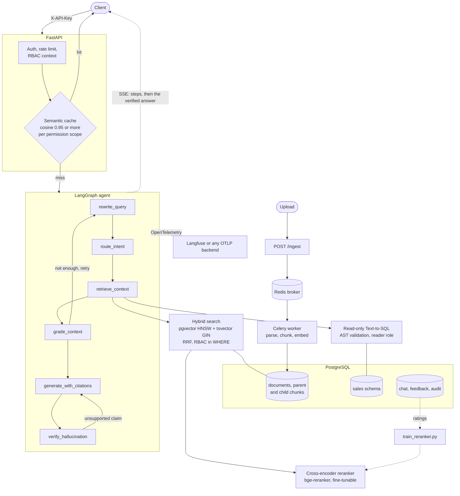

# Enterprise RAG Engine

[](https://github.com/Marwankhater/enterprise-rag-engine/actions/workflows/ci_eval.yml)


A question-answering service for company knowledge. It answers from documents (PDF, Word,
Markdown, text) and from a SQL database in the same conversation, and only ever uses what the person
asking is allowed to see. Every answer cites its sources and is checked against them before it is
sent; when the evidence is not there, it says so instead of guessing.

The whole stack runs on free components: local embedding and reranking models, PostgreSQL, Redis,
Celery, and any OpenAI-compatible model endpoint (the Groq free tier by default, or a local Ollama).

## Architecture



## What it does

| Capability | How |
|---|---|
| Layout-aware ingestion | PDF headings from font sizes, tables kept whole as Markdown, DOCX heading styles and tables, page numbers kept for citations |
| Parent and child chunks | Children of about 300 tokens are searched; their parent section of about 1500 tokens is what the model reads |
| Hybrid retrieval | Dense (pgvector HNSW, cosine) and sparse (PostgreSQL full text, GIN) fused with Reciprocal Rank Fusion in one SQL query |
| Document-level access control | Department and clearance level on every chunk, filtered inside the retrieval query before ranking |
| Reranking | Cross-encoder (`BAAI/bge-reranker-base` or a local fine-tuned checkpoint) on the top candidates |
| Structured data | Text-to-SQL over a sales schema, behind four independent safety layers |
| Agent | LangGraph state machine that rewrites follow-ups, routes between documents and SQL, grades the evidence, retries with a new query, cites, and verifies claims |
| Streaming | Server-Sent Events: progress for each step, then the answer once it has passed verification |
| Semantic cache | Redis Stack vector search, scoped by permission set and invalidated on every ingest |
| Observability | JSON logs with request and trace ids, OpenTelemetry spans with model token usage, Langfuse compatible |
| Evaluation | 62-case golden set, retrieval metrics on every push, Ragas faithfulness and context recall as a CI gate |
| Active learning | Answer ratings are stored with the passages used, and become training data for the reranker |

## Design decisions

**Access control is part of retrieval, not a filter after it.** Each child chunk carries its
document's `department_id` and `access_level`, and both candidate queries (dense and sparse) filter
on them in `WHERE`. Filtering after ranking would return fewer results than asked for, and the
ranking itself would be shaped by documents the user cannot see. pgvector's `hnsw.iterative_scan`
keeps the HNSW scan going until enough rows pass the filter.

**A refusal does not reveal that a restricted document exists.** Asking about something you
cannot read gets the same reply as asking about something that is not in the corpus.

**The answer is streamed after it is verified.** The stream sends a progress event for each graph
step, and the answer tokens only after `verify_hallucination` has passed. The first token comes a
little later, but no one ever reads a claim that is then retracted.

**Verification is two checks.** A cheap one first: every number in the answer must appear in the
sources. Then a model check of each claim. An unsupported claim triggers one regeneration with the
claims listed; if it still fails, the reply is a refusal.

**Text-to-SQL never trusts the model.** (1) `sqlglot` parses the query and only a single `SELECT`
over the allow-listed `sales` tables passes, with no `SELECT INTO`, row locks, `pg_*` functions or
table functions, and a `LIMIT` is forced on. (2) It runs as `rag_reader`, a role that can only
`SELECT` from the sales schema. (3) That role defaults to read-only transactions and the session
sets `READ ONLY` too. (4) A statement timeout bounds every query. The test suite runs a list of
attacks against layer 1, and checks that the role alone already refuses writes.

**The cache is scoped by permissions.** Two people with the same clearance and departments share
cached answers; anyone else never sees them, even for the same question. Each ingest bumps an epoch
so older answers stop matching. Only first-turn questions are cached, because a follow-up depends
on the conversation before it.

**Free by default.** Embeddings (`intfloat/multilingual-e5-small`, Arabic and English) and the
reranker run locally on CPU, so documents never leave the server for indexing. The chat model is
any OpenAI-compatible endpoint, and the code paths that need a model are the only ones that cost
anything.

## Quick start

```bash
cp .env.example .env    # set POSTGRES_PASSWORD, SQL_READER_PASSWORD, LLM_API_KEY, API_KEYS
docker compose up -d --build
```

`migrate` applies the migrations, seeds the sample sales data and ingests the documents in
`examples/` with the access rules in `examples/manifest.json`. Then:

```bash
curl -N http://localhost:8000/api/v1/chat \
  -H "X-API-Key: <a key from API_KEYS>" -H "Content-Type: application/json" \
  -d '{"question": "How many refunded orders did we have in Q1 2026, and what is the refund window?"}'
```

```text
event: status   data: {"step": "rewrite_query", "label": "Understanding the question"}
event: status   data: {"step": "route_intent", "label": "Choosing sources"}
event: status   data: {"step": "retrieve_context", "label": "Searching documents and data"}
...
event: token    data: {"text": "There were "}
event: final    data: {"message_id": "...", "citations": [...], "intent": "hybrid_both", ...}
```

Self-hosted Langfuse: `docker compose --profile observability up -d` (fill the Langfuse values in
`.env` first), or point `LANGFUSE_HOST` and the keys at Langfuse Cloud.

### API

| Method | Path | |
|---|---|---|
| `POST` | `/api/v1/chat` | Ask a question. SSE by default, JSON with `"stream": false`. Pass `session_id` to continue a conversation |
| `GET` | `/api/v1/chat/{session_id}/history` | Your messages in a session |
| `POST` | `/api/v1/ingest` | Multipart upload with `access_level` and `department_id`. Returns a job; ingestion runs on the worker |
| `GET` | `/api/v1/ingest/{job_id}` | Job status, document id and chunk counts |
| `POST` | `/api/v1/feedback` | Rate an answer `1` or `-1`, with an optional comment |
| `GET` | `/health`, `/health/ready` | Liveness, and readiness of PostgreSQL and Redis |

Nobody can ingest a document above their own clearance or into a department they are not in.

## Results

Retrieval on the 38 answerable single-turn cases of the golden set, from the `retrieval-eval` CI job
([run](https://github.com/Marwankhater/enterprise-rag-engine/actions/runs/45409205200)), with
`intfloat/multilingual-e5-small` embeddings. A hit means the section holding the reference passage
was retrieved.

| Retrieval | hit@1 | hit@5 | MRR@10 |
|---|---|---|---|
| Dense only (pgvector) | 0.684 | 0.974 | 0.811 |
| Sparse only (full text) | 0.632 | 0.974 | 0.789 |
| Hybrid (RRF) | 0.711 | 0.974 | 0.835 |
| Hybrid + `bge-reranker-base` | **0.737** | **1.000** | **0.850** |

Access-control leaks (a document the asker cannot read appearing in the top 30, over all 62
cases): **0**.

Hybrid search finds the right section first more often than either retriever alone, and the
reranker lifts it again and brings every reference passage into the top five. The end-to-end Ragas
scores are produced by the `quality-gate` job once the repository has an `LLM_API_KEY` secret.

## Evaluation

`tests/golden_dataset.json` holds 62 questions over the sample corpus and sales data: single-hop,
multi-hop across documents, exact technical tokens, unanswerable, access-restricted, SQL only,
SQL plus a document, Arabic, and follow-ups that need the previous turn. Every reference passage
and every SQL value is checked by the test suite against the documents and the seeded database.

```bash
python -m ml_pipeline.evaluate_rag retrieval            # hit@1, hit@5, MRR@10 per retrieval mode
python -m ml_pipeline.evaluate_rag end-to-end --gate    # Ragas plus refusal, SQL and leak checks
```

The retrieval stage compares dense only, sparse only, hybrid, and hybrid with the reranker, and
counts access-control leaks. The end-to-end stage runs the agent on every case and reports Ragas
faithfulness, context recall and answer relevancy, refusal accuracy, SQL accuracy, citation rate,
latency and tokens. With `--gate` it fails when faithfulness is below 0.85, context recall below
0.80, refusal accuracy below 0.85, or any citation comes from a document the asker cannot read.

In CI, `test` and `retrieval-eval` run on every push. `quality-gate` runs when the repository has
an `LLM_API_KEY` secret; by default it scores a fixed, category-balanced sample of 24 cases to stay
within free-tier rate limits, and a manual run can score all 62.

## Fine-tuning the reranker

```bash
python -m ml_pipeline.train_reranker build-data --questions-per-chunk 3
python -m ml_pipeline.train_reranker train --epochs 2
RERANKER_MODEL=ml_pipeline/output/reranker-ft  # serve it
```

`build-data` asks the model for questions each chunk answers, then mines hard negatives: chunks
hybrid search ranks highly for that question that come from a different section. Rated answers
from the feedback table are added, with the passages behind a thumbs-up as positives and those
behind a thumbs-down as negatives. Golden-set questions are excluded. `train` holds out whole
documents, scores the base model on them, fine-tunes, scores again and saves both results next
to the model. The `train-reranker` workflow does all of this on a GitHub runner and uploads the
model.

## Development

```bash
pip install -e ".[dev]"             # add ".[models]" for local embeddings and the reranker
docker compose up -d postgres redis
pytest                              # 131 tests; the database tests skip if PostgreSQL is not reachable
ruff check . && ruff format --check .
```

Tests use a real PostgreSQL with pgvector and a real Redis, an offline hashing embedder and a
scripted chat model, so they need no network and no keys.

```text
app/
  api/v1/endpoints/   chat (SSE, cache, history), ingest (upload, job status), feedback
  core/               settings, auth and rate limits, logging and tracing
  db/                 async engine and pool, SQLAlchemy models
  ingestion/          parser, chunker, pipeline, Celery tasks
  retrieval/          embeddings, hybrid search, reranker, SQL tool
  agents/             state, nodes, graph, model client
  cache/              semantic cache
migrations/           Alembic: core schema; sales schema and the read-only role
ml_pipeline/          evaluate_rag.py, train_reranker.py
scripts/              seed_sales.py, ingest_examples.py
examples/             sample corpus (fictional company) and its access manifest
tests/                unit and integration tests, golden_dataset.json
```

## Limitations

- Scanned PDFs are rejected with a clear error; there is no OCR step.
- The sample corpus is small (nine documents), so retrieval scores on it are higher than they
  would be on a large real corpus. The pipeline, not the absolute numbers, is the point.
- The reranker fine-tuning data is mostly synthetic until real feedback accumulates.
- RediSearch only indexes database 0, so the semantic cache needs `REDIS_URL` on database 0 to use
  vector search; on plain Redis it falls back to an in-process scan, which suits development only.

## Credits

This project started from [rag-starter-fastapi](https://github.com/dhairyasenjaliya/rag-starter-fastapi)
by Dhairya Senjaliya (MIT), which provided the original FastAPI and pgvector starting point and three
of the sample documents. It has since been rebuilt into the system described here. MIT licensed; see
[LICENSE](LICENSE).
